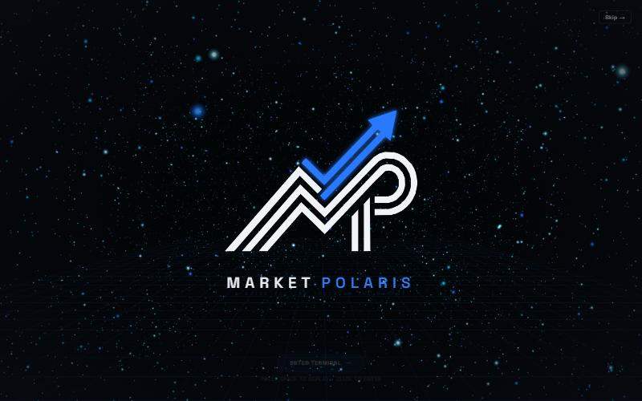
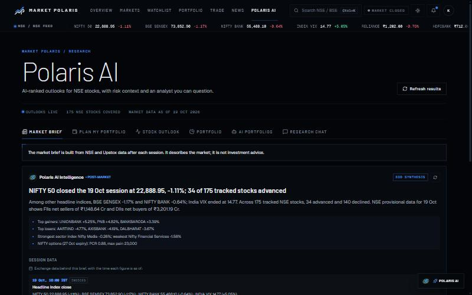
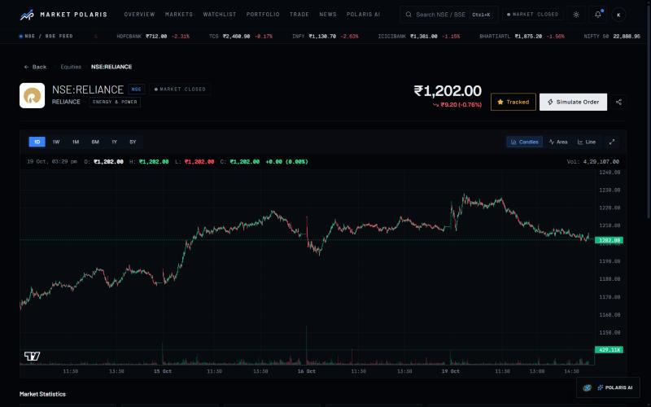
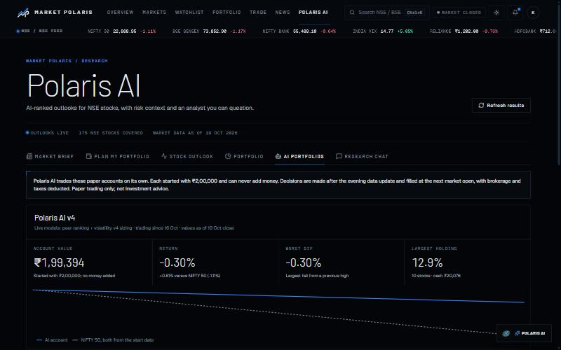
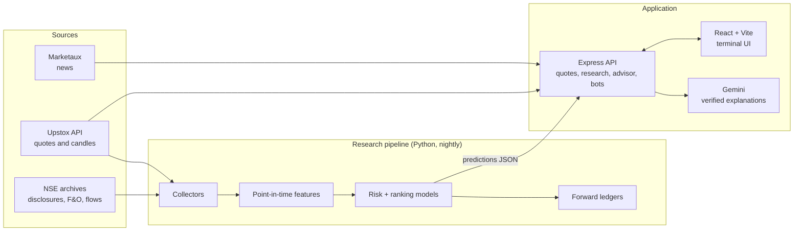

<div align="center">


# Market Polaris

**A guide you can trust in the market.**

Research and paper trading for Indian equities (NSE): live market data, official exchange disclosures, and machine-learning models that are tested on data they never saw before they reach a user.


</div>

<p align="center">
  
  
</p>
<p align="center">
  
  
</p>

---

## Contents

- [What it is](#what-it-is)
- [Features](#features)
- [How Polaris AI works](#how-polaris-ai-works)
- [Architecture](#architecture)
- [Getting started](#getting-started)
- [Configuration](#configuration)
- [Research pipeline](#research-pipeline)
- [Scripts](#scripts)
- [Project structure](#project-structure)
- [Testing](#testing)
- [Data sources](#data-sources)
- [Roadmap](#roadmap)
- [Disclaimer](#disclaimer)
- [License](#license)

## What it is

Market Polaris is a full-stack platform for studying the Indian stock market and practising with virtual money. It brings together:

- **A market terminal:** live NSE and BSE indices, movers, breadth, sector heatmaps, FII/DII flows, NIFTY options data and news.
- **Polaris AI:** research models that estimate risk and relative strength for about 175 liquid NSE stocks, explain their reasoning, and answer questions in plain language.
- **Paper trading:** a simulated broker with real quotes, plus AI-managed paper portfolios that are tracked publicly against the NIFTY 50.

Everything is built around one rule: **a model reaches users only after it has beaten the current one on unseen data, under rules written down before the test.** Ideas that fail are documented, not shipped.

## Features

| Area | What you get |
|---|---|
| **Overview** | An interactive NIFTY 50 chart (hover for any price, scroll or pinch to zoom, earlier sessions load as you zoom out), the post-market brief, index strip, market state, participation and movers |
| **Markets** | Screener and sector heatmap across the covered universe |
| **Stock pages** | Candlestick, area and line charts on 1D to 5Y timeframes, with older history loaded on demand; key statistics, news and an AI insight panel |
| **Polaris AI: Market brief** | A data-built end-of-day synthesis: session summary, the exchange figures behind it, and key NIFTY levels |
| **Polaris AI: Plan my portfolio** | Enter a budget, timeline and risk style, and get a diversified paper portfolio sized to each stock's expected risk, with a daily check-up and a public track record |
| **Polaris AI: Stock outlook** | Probability that each stock beats its peers over 5 or 20 sessions, the main drivers, and a volatility-risk tier |
| **Polaris AI: AI portfolios** | Autonomous paper accounts (₹2,00,000 each, no top-ups) that trade on the live models, charted against the NIFTY 50, with post-mortems on losing trades |
| **Polaris AI: Research chat** | Questions answered from the platform's own data (prices, filings, model outputs). Every number in a reply is checked against the evidence before it is shown |
| **Paper trading** | Market orders at live prices, positions, P&L, watchlists and price alerts |

## How Polaris AI works

Polaris AI combines two models, refreshed after every market close.

**1. Volatility risk (`pulse-risk-v4`).** This model predicts whether a stock's price swings over the next 20 sessions will be larger than its normal level. Its inputs:
- price-range estimators and volatility seasonality;
- India VIX;
- the upcoming results calendar, from NSE board-meeting notices;
- option implied volatility, from NSE F&O bhavcopies.

On a held-out test period (Dec 2024 to Sep 2026) it scored:

| Metric | Holdout |
|---|---|
| Accuracy | **71.1%** |
| ROC AUC | **0.789** |
| Accuracy on its most confident half | 81.9% |
| Accuracy on its most confident 20% | 87.0% |

It describes risk, not direction. The planner uses it to size positions and to flag stocks whose risk is elevated.

**2. Peer ranking (`pulse-rank-v2`).** This model estimates which stocks are more likely to outperform their peers. The edge is small (about 51–52% accuracy, rank IC ≈ +0.04 over 5 sessions) and is presented as a probability, never a certainty.

**Research protocol.**
- Walk-forward development folds, with the holdout scored once.
- Point-in-time features: disclosures count only after NSE's 18:00 IST cutoff, and global data is lagged.
- Write-once forward ledgers that score every live prediction after the fact.
- Every candidate model has a pre-registered gate.

Candidates that did not pass, and so were not shipped, include:
- LLM-tagged news;
- global markets, oil and the rupee;
- quarterly results figures;
- delivery percentages and bulk/block deals;
- minute-level intraday features.

Full write-ups are in [`ml/RESULTS.md`](ml/RESULTS.md), protocols in [`ml/V5_PROTOCOL.md`](ml/V5_PROTOCOL.md) and [`ml/FILING_READER_PROTOCOL.md`](ml/FILING_READER_PROTOCOL.md).

## Architecture



## Getting started

### Prerequisites

- **Node.js 20+** and npm
- **Python 3.10+**, only for the research pipeline
- Optional: **Docker**, for PostgreSQL. Without a database, paper trades are kept in memory and reset on restart.

### 1. Install

```bash
git clone https://github.com/kartikay633/MarketPolaris.git
cd MarketPolaris
npm install
```

### 2. Configure

```bash
cp .env.example .env
```

Fill in the keys you have (see [Configuration](#configuration)). The app starts with none of them, and each section shows a clear "unavailable" state until its source is configured.

### 3. Run

```bash
npm run dev
```

This starts the API on **http://localhost:3001** and the web app on **http://localhost:5173**.

### 4. Optional: PostgreSQL

```bash
docker compose up -d
npm run db:migrate
```

## Configuration

All settings live in `.env`, which is git-ignored. Never commit real keys.

| Variable | Needed for | Required |
|---|---|---|
| `UPSTOX_ANALYTICS_TOKEN` | Live quotes, charts and research data collection | Recommended |
| `GEMINI_API_KEY` | Written AI explanations and research chat (the app falls back to data-built answers without it) | Optional |
| `PULSE_GEMINI_MODEL`, `PULSE_GEMINI_FALLBACK_MODELS` | Gemini model choice and fallback order | Optional |
| `NEWS_API_KEY` | Market news (Marketaux) | Optional |
| `VITE_SUPABASE_URL`, `VITE_SUPABASE_ANON_KEY`, `SUPABASE_JWT_SECRET`, `SUPABASE_SERVICE_ROLE_KEY` | Sign-in with Supabase (a local demo account is used otherwise) | Optional |
| `DATABASE_URL` | PostgreSQL storage for paper trading | Optional |
| `VITE_CONTACT_EMAIL` | Address shown on the Contact page | Optional |
| `PULSE_PYTHON` | Path to the research Python interpreter (default `.venv-pulse`) | Optional |
| `PULSE_MINUTE_DIR`, `PULSE_FILING_DIR` | Storage for 1-minute candles and filing PDFs (large; kept outside the repo) | Optional |

## Research pipeline

The models are trained and refreshed by a local pipeline. Its data and model files live in `data/pulse/`, which is git-ignored.

```bash
# one-time setup
python -m venv .venv-pulse
.venv-pulse/Scripts/pip install -r ml/requirements.txt      # Windows
# .venv-pulse/bin/pip install -r ml/requirements.txt        # macOS / Linux

npm run research:collect   # download candles for the research universe
npm run research:train     # build features, run walk-forward evaluation, score the holdout, write predictions
npm run research:update    # nightly: collect new data and refresh predictions
npm run research:daily     # update, score forward ledgers, record advisor plans, step the AI portfolios
```

`research:daily` is designed to run once per weekday evening after the market data settles. On Windows it can be scheduled with Task Scheduler using `scripts/pulse-daily.vbs`, which runs without a console window.

## Scripts

| Command | Description |
|---|---|
| `npm run dev` | API and web app together, with hot reload |
| `npm run server` / `npm run client:dev` | API only / web app only |
| `npm run build` / `npm run preview` | Production build of the web app / serve that build locally |
| `npm run db:migrate` | Apply PostgreSQL migrations |
| `npm run research:collect` | Collect market data for the research universe |
| `npm run research:news` | Collect official disclosures and news |
| `npm run research:train` | Full train and evaluation run |
| `npm run research:update` / `research:infer` | Nightly refresh / predictions only |
| `npm run research:forward` | Score matured forward predictions |
| `npm run research:daily` | The complete nightly job |
| `npm run test:research` | Node and Python research test suites |

## Project structure

```
MarketPolaris/
├── src/                    React app
│   ├── app/
│   │   ├── pages/          Overview, Markets, Stock, Polaris AI, Trade, Portfolio, …
│   │   ├── components/     Charts, AI panels, research views, layout, common UI
│   │   ├── hooks/          React Query data hooks
│   │   └── styles/         Design system (flight-deck theme)
│   └── intro/              3D intro (Three.js + GSAP)
├── server/                 Express API
│   ├── providers/          Upstox, Marketaux, NSE clients
│   ├── research/           Research status, advisor, AI portfolios, verified chat
│   ├── services/           Market data, trading, AI, news
│   └── routes/ …           REST endpoints
├── ml/                     Python research: features, models, studies, protocols
├── scripts/                Pipeline entry points (collection, training, nightly job)
├── tests/                  Node test suites
├── docs/                   Strategy notes and screenshots
└── public/                 Logo and static assets
```

## Testing

```bash
node --test tests/          # API, research, advisor, bots and data-integrity tests
npm run test:research       # adds the Python model and feature tests (no-lookahead checks)
npm run build               # production build check
```

## Data sources

- **Upstox:** quotes, intraday and historical candles, NIFTY option chain.
- **NSE:** corporate announcements, board meetings, F&O bhavcopies, turnover and provisional FII/DII data.
- **Marketaux:** financial news.
- **Google Gemini:** written explanations, constrained to the platform's own evidence.
- **TradingView Lightweight Charts:** charting library.

Data is used under each provider's terms. Market data is not redistributed.

## Roadmap

- **Filing reader.** A local LLM reads full NSE filings for facts the headline misses. It is in its pilot, with a 9-out-of-10 accuracy bar before any rollout.
- **Next model version.** It replaces v4 only if it passes the pre-registered gates, then a live shadow period.
- **Holdings watch.** Alerts on material filings for the stocks you hold.
- **Live track record.** Months of public forward results for the AI portfolios before any real-money service.

## Disclaimer

Market Polaris is for **research, education and paper trading only**. Nothing in this repository or the application is investment advice or a recommendation to buy, sell or hold any security. Market Polaris is **not registered with SEBI** as a Research Analyst or Investment Adviser. Model outputs are statistical estimates and can be wrong. Past and simulated performance does not guarantee future results. Investments in securities are subject to market risks.

## License

Copyright © 2026 Market Polaris. All rights reserved.

This source code is shared for viewing and evaluation. No licence is granted to copy, modify or distribute it without written permission.
